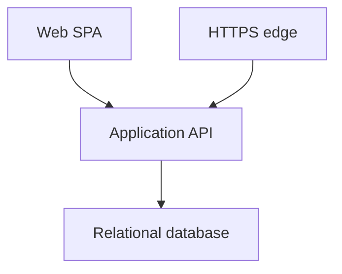
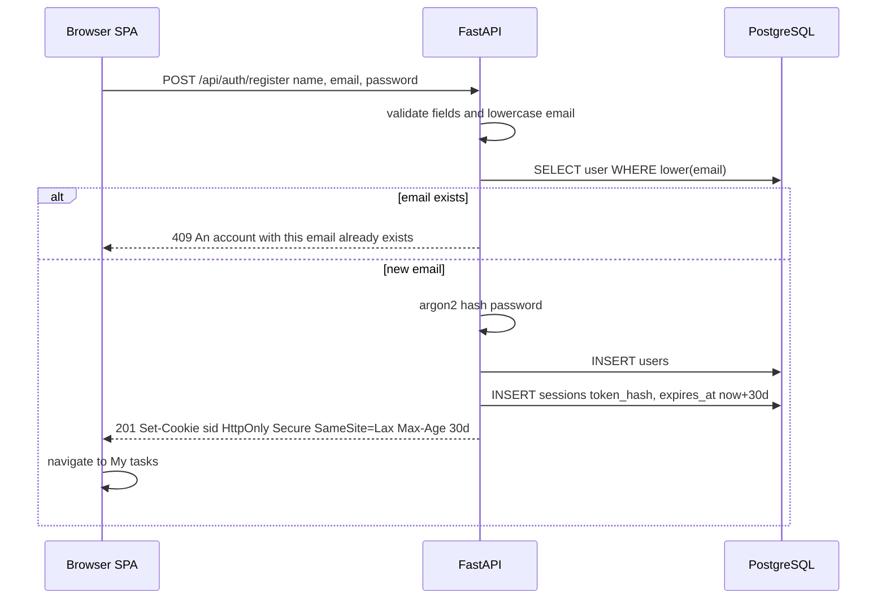
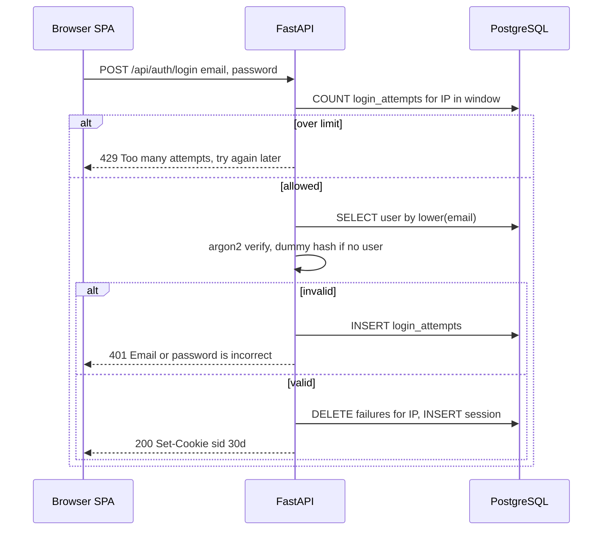
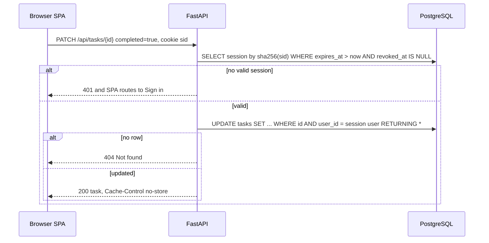
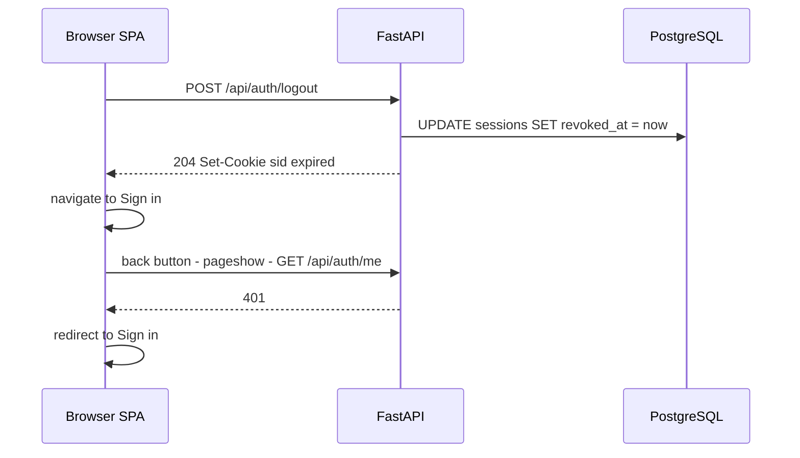
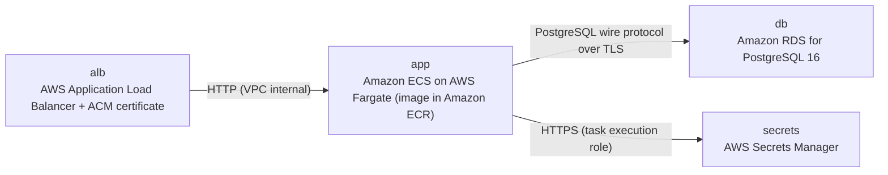

# Architecture

> Maintained by QuorQ AI SDLC. Text between `sdlc:auto` markers is regenerated; anything outside them is yours and is kept.

<!-- sdlc:auto:start narrative -->
## Overview

### ARCH-001 · approved · source: architecture:v1

Approved architecture (Version 1) for a small, same-origin To-Do app with authentication. It is sized for a private group of tens of users. A React 19 SPA is served by a FastAPI 0.115 backend, with PostgreSQL 16 on RDS, deployed as one ECS Fargate container behind an HTTPS ALB.

- Status: approved; Version: 1.
- Scale: private group of tens of users.
- Frontend: React 19 single-page app with three pages: Sign up, Sign in, My tasks.
- Backend: FastAPI 0.115.
  - Exposes a compact JSON API under /api.
  - Also serves the built SPA, so cookies stay same-site and there are no CORS concerns.
- Database: PostgreSQL 16 on Amazon RDS. Stores users, tasks, server-side sessions and sign-in attempt records.
- Passwords: hashed with Argon2.
- Sessions:
  - Random opaque tokens in an HttpOnly, Secure, SameSite=Lax cookie lasting 30 days.
  - Only a hash of each token is stored server-side.
  - Sign-out invalidates the session immediately.
- Data isolation:
  - Every task query is scoped by the user ID from the session.
  - Another user's task returns 404, so nothing is revealed about it.
- Throttling: sign-in throttling is done in PostgreSQL, with no extra cache service.
- Hosting: on AWS, one ECS Fargate container behind an HTTPS Application Load Balancer.
- Durability: RDS automated backups are the safety net for durable data.
- Out of scope (from the project description): password reset, social login, roles.

**Related:** ARCH-COMP-WEB_SPA, ARCH-COMP-API, ARCH-COMP-DB, ARCH-COMP-EDGE, ARCH-DEPLOY, ARCH-DATA, ARCH-API

### ARCH-COMP-WEB_SPA · approved · source: architecture:v1:components.web_spa

Web SPA (React 19). It provides the Sign up, Sign in and My tasks pages with a responsive layout. It also handles client-side validation, route guards and optimistic task updates.

- Pages: Sign up, Sign in, My tasks.
- Responsive layout that works down to 375px.
- Client-side validation.
- Route guards:
  - Based on GET /api/auth/me.
  - Signed-in users are redirected away from the Sign in and Sign up pages.
- Optimistic updates:
  - Add, edit, toggle and delete update the screen immediately.
  - Changes roll back on error.
- Task editing: inline edit field.
- Deleting asks for confirmation.
- On a pageshow event restored from the back-forward cache, the SPA re-checks the session.
- related_ids are inferred by matching these features to the endpoint mappings given in the input.

**Related:** US-006, US-007, US-008, US-010, US-011, US-012, US-013, US-014, ARCH-CP-004

### ARCH-COMP-API · approved · source: architecture:v1:components.api

Application API (FastAPI 0.115). It provides the auth and task endpoints and handles password hashing, sessions and sign-in throttling. It also enforces task ownership, validates input server-side and serves the SPA.

- Auth endpoints: register, login, logout, me.
- Task endpoints: list, create, update, delete.
- Passwords: hashed and verified with Argon2.
- Emails: normalised to lower case.
- Sessions: issued, validated and revoked by the API.
- Throttling: sign-in attempts are throttled per source IP.
- Ownership: enforced on every task query using the session user ID.
- Validation: server-side, through Pydantic.
- Caching: sets Cache-Control: no-store on private responses.
- Static files: serves the built SPA with a fallback to index.html.
- NFR-003 (session auth and ownership) and NFR-006 (server-side validation) are cited in the input's Backend technology decision. They are not in the known requirement key list.

**Related:** US-001, US-002, US-003, US-004, US-005, US-006, US-007, US-008, US-010, US-011, US-012, US-013, US-014, US-015, NFR-003, NFR-006, ARCH-API

### ARCH-COMP-DB · approved · source: architecture:v1:components.db

Relational database (PostgreSQL 16 on Amazon RDS). It provides durable storage for users, tasks, sessions and login attempts. It enforces data integrity and has automated backups enabled.

- Stores: users, tasks, sessions, login_attempts.
- Integrity: enforces the task-to-user foreign key.
- Unique email: case-insensitive, enforced by a unique index on lower(email).
- Backups: automated backups enabled.

**Related:** ARCH-DATA, US-001, US-003

### ARCH-COMP-EDGE · approved · source: architecture:v1:components.edge

HTTPS edge (AWS Application Load Balancer). It terminates TLS, redirects HTTP to HTTPS and forwards traffic to the API container. It also runs health checks.

- TLS: terminated with an ACM certificate.
- HTTP traffic is redirected to HTTPS.
- Forwards traffic to the API container.
- Runs health checks against GET /api/health.

**Related:** ARCH-DEPLOY

### ARCH-CP-001 · approved · source: architecture:v1:critical_paths.register

Register and auto sign-in. The API validates the new account details, rejects duplicate emails with 409 and hashes the password with Argon2. It then creates a session so the user lands directly on My tasks.

1. The SPA posts name, email and password.
2. The API validates the input:
   - Name: trimmed and non-empty.
   - Email: passes EmailStr.
   - Password: at least 8 characters.
3. The email is lowercased and checked for uniqueness.
4. A duplicate returns 409 with 'An account with this email already exists'.
5. Otherwise the API:
   - Hashes the password with Argon2.
   - Inserts the user.
   - Creates a session and sets the cookie.
6. The SPA navigates to My tasks.
- Security: the plaintext password is never logged.
- Endpoint: POST /api/auth/register (US-001, US-002).

**Related:** US-001, US-002, ARCH-COMP-API

### ARCH-CP-002 · approved · source: architecture:v1:critical_paths.signin

Sign in with per-IP throttling and a generic failure message. Failed attempts are tracked in login_attempts. Unknown emails still get a dummy Argon2 verify so response timing stays uniform.

- Throttling:
  - The API counts failed attempts from the source IP inside the configured window, using login_attempts.
  - Defaults: 5 attempts in 15 minutes, then a 15-minute cooldown. All values are set through env.
  - Over the limit, it returns 429 with a neutral message, regardless of the email.
- Unknown email: a dummy Argon2 verify still runs so timing stays uniform.
- Any failure:
  - Records an attempt.
  - Returns 401 'Email or password is incorrect'.
- Success:
  - Clears the IP's failures.
  - Creates a session.
- Endpoint: POST /api/auth/login (US-003, US-004, US-005).

**Related:** US-003, US-004, US-005, ARCH-COMP-API

### ARCH-CP-003 · approved · source: architecture:v1:critical_paths.task_update

Authenticated, ownership-scoped task update. Every task query is scoped to the user from the session. Missing tasks and other users' tasks both return 404, so nothing is revealed.

- get_current_user dependency:
  - Hashes the cookie token.
  - Loads a session that is not expired and not revoked.
  - Returns 401 if there is no such session.
- Ownership:
  - Every task query includes user_id = the session user.
  - The user ID is taken only from the session.
- A missing row and another user's row both return 404, so the response reveals nothing.
- PATCH accepts a title and/or completed:
  - Title: 1-255 characters after trimming.
- created_at is never changed, so list position is preserved.
- Endpoint: PATCH /api/tasks/{id} (US-012, US-013).

**Related:** US-012, US-013, NFR-003, ARCH-COMP-API

### ARCH-CP-004 · approved · source: architecture:v1:critical_paths.signout

Sign out and stale-page protection. Logout revokes the server-side session and clears the cookie. no-store headers and a back-forward cache re-check stop My tasks from showing after sign-out.

- Logout:
  - Sets revoked_at on the session.
  - Clears the cookie.
  - The SPA then navigates to Sign in.
- Private API responses carry Cache-Control: no-store.
- Back-forward cache:
  - On a pageshow event with persisted=true, the SPA re-calls /api/auth/me.
  - On a 401, it redirects to Sign in.
  - Result: the back button never shows My tasks after sign-out.
- Endpoints:
  - POST /api/auth/logout (US-007).
  - GET /api/auth/me (US-006, US-008).

**Related:** US-007, US-006, US-008, ARCH-COMP-WEB_SPA, ARCH-COMP-API

### ARCH-DATA · approved · source: architecture:v1:entities

Data model with four entities: users, tasks, sessions and login_attempts. Tasks reference users by foreign key. Sessions store only a hash of each token.

- users: id, name, email, password_hash.
  - Email is unique case-insensitively via a unique index on lower(email).
- tasks: id, user_id, title, completed, created_at.
  - user_id is a foreign key to users.
- sessions: id, user_id, token_hash, created_at, expires_at, revoked_at.
- login_attempts: id, source_ip, attempted_at.

**Related:** ARCH-COMP-DB

### ARCH-API · approved · source: architecture:v1:endpoints

JSON API under /api: four auth endpoints, four task endpoints and a health check. Each endpoint's requirement mapping is taken directly from the input.

- POST /api/auth/register: create an account and sign in automatically (US-001, US-002).
- POST /api/auth/login: sign in with email and password, throttled per source IP (US-003, US-004, US-005).
- POST /api/auth/logout: revoke the server-side session and clear the cookie (US-007).
- GET /api/auth/me: return the current user, used by the SPA route guards (US-006, US-008).
- GET /api/tasks: list the signed-in user's tasks, newest first, unpaginated (US-011, US-015).
- POST /api/tasks: create a task (US-010).
- PATCH /api/tasks/{id}: edit the title and/or set completed (US-012, US-013).
- DELETE /api/tasks/{id}: permanently delete a task (US-014).
- GET /api/health: load balancer health check.
- Traceability gap: US-009 and US-016 to US-019 are not mapped to any endpoint in the architecture input.

**Related:** US-001, US-002, US-003, US-004, US-005, US-006, US-007, US-008, US-010, US-011, US-012, US-013, US-014, US-015

### ARCH-DEPLOY · approved · source: architecture:v1:deployment_nodes

AWS deployment topology: ALB with an ACM certificate, one ECS Fargate app container, a small encrypted RDS PostgreSQL instance and Secrets Manager.

- alb: AWS Application Load Balancer + ACM certificate.
  - Managed.
  - HTTPS on 443, with HTTP-to-HTTPS redirect.
- app: Amazon ECS on AWS Fargate, image in Amazon ECR.
  - Python 3.12 container running FastAPI 0.115 under uvicorn.
  - Serves the React 19 build as static files.
- db: Amazon RDS for PostgreSQL 16, db.t4g.micro.
  - Private subnet.
  - Storage encryption enabled.
  - Automated backups kept for 7 days.
- secrets: AWS Secrets Manager.
  - Holds DATABASE_URL and SESSION_SECRET.
  - Injected into the ECS task.

**Related:** ARCH-COMP-EDGE, ARCH-COMP-API, ARCH-COMP-DB

### ARCH-TECH-FRONTEND · approved · source: architecture:v1:tech_decisions.frontend

Frontend: React 19 was chosen over Vue and Svelte. It is built with Vite and served from the same origin as the API.

- Choice: React 19.
- Alternatives considered: Vue, Svelte.
- Rationale:
  - Built with Vite into static assets that FastAPI serves from the same origin.
  - The three routes are guarded by a /api/auth/me check.
  - Optimistic state updates make ticking, inline editing and deleting feel instant.
  - Mobile-first CSS meets the 375px target.

**Related:** ARCH-COMP-WEB_SPA

### ARCH-TECH-BACKEND · approved · source: architecture:v1:tech_decisions.backend

Backend: FastAPI 0.115 was chosen over Django and Express. Pydantic gives declarative server-side validation, and a single dependency enforces session auth and ownership.

- Choice: FastAPI 0.115.
- Alternatives considered: Django, Express.
- Rationale:
  - Pydantic models express the validation rules declaratively and server-side (NFR-006):
    - Name.
    - Email.
    - Password of at least 8 characters.
    - Title of 1-255 characters.
  - A single get_current_user dependency enforces session auth and ownership on every task route (NFR-003).

**Related:** ARCH-COMP-API, NFR-003, NFR-006

### ARCH-TECH-DATABASE · approved · source: architecture:v1:tech_decisions.database

Database: PostgreSQL 16 was chosen over MySQL and SQLite. It also handles sessions and throttling, so no Redis or other cache is needed.

- Choice: PostgreSQL 16.
- Alternatives considered: MySQL, SQLite.
- Rationale:
  - Enforces the tasks-to-users foreign key.
  - Enforces the case-insensitive unique email.
  - Absorbs server-side sessions and sign-in throttling, so no Redis or other cache is added.

**Related:** ARCH-COMP-DB

### ARCH-TECH-CLOUD · approved · source: architecture:v1:tech_decisions.cloud

Cloud: AWS was chosen over Azure and GCP. A minimal footprint keeps cost low.

- Choice: AWS.
- Alternatives considered: Azure, GCP.
- Rationale:
  - One ECS Fargate task behind an ALB keeps cost low.
  - A small RDS instance provides automated backups and encryption at rest.
  - Secrets Manager holds the session secret.

**Related:** ARCH-DEPLOY
<!-- sdlc:auto:end narrative -->

<!-- sdlc:auto:start building-blocks -->
## Building Block View

| ID | Name | Technology | Responsibility | Depends on |
|---|---|---|---|---|
| web_spa | Web SPA | React 19 | Provides the Sign up, Sign in and My tasks pages with a responsive layout that works down to 375px. It runs client-side validation and route guards based on GET /api/auth/me, and redirects signed-in users away from the Sign in and Sign up pages. It does optimistic add, edit, toggle and delete with rollback on error, shows an inline edit field, and asks for confirmation before deleting. On a pageshow event restored from the back-forward cache, it re-checks the session. | api |
| api | Application API | FastAPI 0.115 | Provides the auth endpoints (register, login, logout, me) and the task endpoints (list, create, update, delete). It hashes and verifies passwords with Argon2 and normalises emails to lower case. It issues, validates and revokes sessions, and throttles sign-in attempts per source IP. It enforces ownership on every task query using the session user ID and runs server-side validation through Pydantic. It sets Cache-Control: no-store on private responses and serves the built SPA static files with a fallback to index.html. | db |
| db | Relational database | PostgreSQL 16 (Amazon RDS) | Durable storage for users, tasks, sessions and login attempts. It enforces the task-to-user foreign key and a case-insensitive unique email through a unique index on lower(email). Automated backups are enabled. | — |
| edge | HTTPS edge | AWS Application Load Balancer | Terminates TLS with an ACM certificate, redirects HTTP to HTTPS, forwards traffic to the API container and runs health checks. | api |

<!-- sdlc:auto:end building-blocks -->

<!-- sdlc:auto:start runtime -->
## Runtime View

### Register and auto sign-in

The SPA posts name, email and password. The API validates them: name is trimmed and non-empty, the email passes EmailStr, and the password is at least 8 characters. The email is lowercased and checked for uniqueness. A duplicate returns 409 with 'An account with this email already exists'. Otherwise the API hashes the password with Argon2, inserts the user, creates a session and sets the cookie. The SPA then navigates to My tasks. The plaintext password is never logged.

- **Components:** web_spa, api, db
- **Modules:** app/routers/auth.py, app/services/auth_service.py, app/services/session_service.py, app/schemas/auth.py, web/src/pages/SignUp.tsx
- **Key functions:** register(payload: RegisterIn, response), hash_password(plain), create_session(user_id) -> token, set_session_cookie(response, token)

### Sign in with throttling and generic failure

The API counts failed attempts from the source IP inside the configured window, using login_attempts. Defaults are 5 attempts in 15 minutes and a 15-minute cooldown, set through env. Over the limit, it returns 429 with a neutral message regardless of the email. For an unknown email it still runs a dummy Argon2 verify so timing stays uniform. Any failure records an attempt and returns 401 'Email or password is incorrect'. Success clears the IP's failures and creates a session.

- **Components:** web_spa, api, db
- **Modules:** app/routers/auth.py, app/services/auth_service.py, app/services/throttle_service.py, web/src/pages/SignIn.tsx
- **Key functions:** login(payload: LoginIn, request, response), is_throttled(ip) -> bool, record_failure(ip), verify_password(hash, plain), create_session(user_id)

### Authenticated, ownership-scoped task update

A get_current_user dependency hashes the cookie token and loads a session that is not expired and not revoked. If there is none, it returns 401. Every task query includes user_id = the session user, taken only from the session. A missing row or another user's row both return 404, so the response reveals nothing. PATCH accepts a title (1-255 after trimming) and/or completed. created_at is never changed, so list position is preserved.

- **Components:** web_spa, api, db
- **Modules:** app/deps.py, app/routers/tasks.py, app/services/task_service.py, app/schemas/task.py, web/src/pages/MyTasks.tsx
- **Key functions:** get_current_user(request) -> User, list_tasks(user_id), create_task(user_id, title), update_task(user_id, task_id, patch), delete_task(user_id, task_id)

### Sign out and stale-page protection

Logout sets revoked_at on the session and clears the cookie. The SPA then navigates to Sign in. Private API responses carry Cache-Control no-store. On a pageshow event with persisted=true, the SPA re-calls /api/auth/me and redirects to Sign in on 401, so the back button never shows My tasks after sign-out.

- **Components:** web_spa, api, db
- **Modules:** app/routers/auth.py, app/services/session_service.py, web/src/auth/RequireAuth.tsx
- **Key functions:** logout(request, response), revoke_session(token), useSessionGuard()

<!-- sdlc:auto:end runtime -->

<!-- sdlc:auto:start deployment-view -->
## Deployment View

| Name | Service | Runtime | Scaling | Environment |
|---|---|---|---|---|
| alb | AWS Application Load Balancer + ACM certificate | Managed, HTTPS 443 with HTTP to HTTPS redirect | Managed | dev |
| app | Amazon ECS on AWS Fargate (image in Amazon ECR) | Python 3.12 container running FastAPI 0.115 under uvicorn, serving the React 19 build as static files | 1 task (0.25 vCPU / 0.5 GB). Can scale horizontally because sessions and throttling live in PostgreSQL | dev |
| db | Amazon RDS for PostgreSQL 16 | db.t4g.micro, private subnet, storage encryption enabled, automated backups 7 days | Single-AZ for dev | dev |
| secrets | AWS Secrets Manager | Holds DATABASE_URL and SESSION_SECRET, injected into the ECS task | Managed | dev |

| Source | Target | Protocol |
|---|---|---|
| alb | app | HTTP (VPC internal) |
| app | db | PostgreSQL wire protocol over TLS |
| app | secrets | HTTPS (task execution role) |

<!-- sdlc:auto:end deployment-view -->

<!-- sdlc:auto:start decisions -->
## Architecture Decisions

| Layer | Choice | ADR |
|---|---|---|
| Frontend | React 19 | [ADR-0001](adr/frontend.md) |
| Backend | FastAPI 0.115 | [ADR-0002](adr/backend.md) |
| Database | PostgreSQL 16 | [ADR-0003](adr/database.md) |
| Cloud | AWS | [ADR-0004](adr/cloud.md) |
<!-- sdlc:auto:end decisions -->

<!-- sdlc:auto:start links -->
## Related Documents

- [Data Model](data-model.md)
- [API Specification](api/openapi.yaml)
- [Architecture Decision Records](adr/README.md)
<!-- sdlc:auto:end links -->
