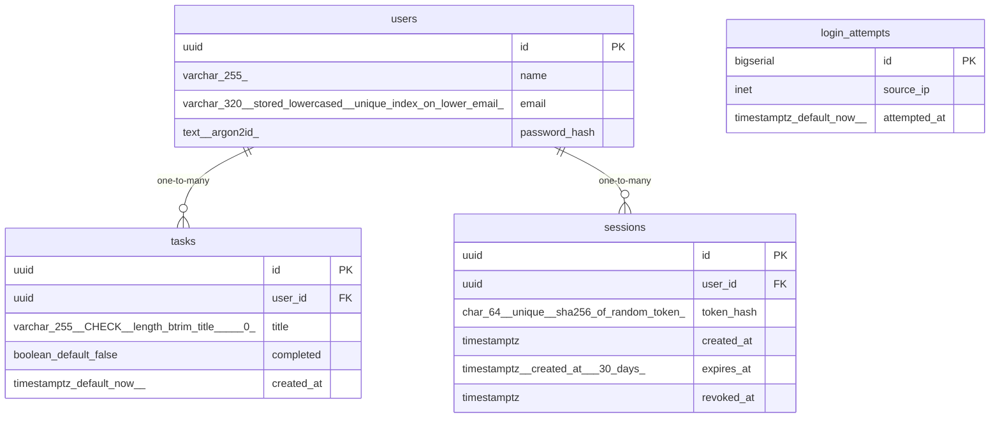

# Data Model

<!-- sdlc:auto:start entities -->
### users

| Field | Type | PK | FK | Nullable |
|---|---|---|---|---|
| id | uuid | True | — | False |
| name | varchar(255) | False | — | False |
| email | varchar(320) stored lowercased, unique index on lower(email) | False | — | False |
| password_hash | text (argon2id) | False | — | False |

### tasks

| Field | Type | PK | FK | Nullable |
|---|---|---|---|---|
| id | uuid | True | — | False |
| user_id | uuid | False | users.id | False |
| title | varchar(255) CHECK (length(btrim(title)) > 0) | False | — | False |
| completed | boolean default false | False | — | False |
| created_at | timestamptz default now() | False | — | False |

### sessions

| Field | Type | PK | FK | Nullable |
|---|---|---|---|---|
| id | uuid | True | — | False |
| user_id | uuid | False | users.id | False |
| token_hash | char(64) unique (sha256 of random token) | False | — | False |
| created_at | timestamptz | False | — | False |
| expires_at | timestamptz (created_at + 30 days) | False | — | False |
| revoked_at | timestamptz | False | — | True |

### login_attempts

| Field | Type | PK | FK | Nullable |
|---|---|---|---|---|
| id | bigserial | True | — | False |
| source_ip | inet | False | — | False |
| attempted_at | timestamptz default now() | False | — | False |
<!-- sdlc:auto:end entities -->

<!-- sdlc:auto:start relationships -->
| Source | Target | Type |
|---|---|---|
| users | tasks | one-to-many |
| users | sessions | one-to-many |
<!-- sdlc:auto:end relationships -->

<!-- sdlc:auto:start er-diagram -->

<!-- sdlc:auto:end er-diagram -->
