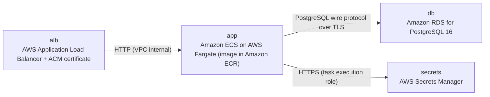

# Deployment Guide

> Maintained by QuorQ AI SDLC. Text between `sdlc:auto` markers is regenerated; anything outside them is yours and is kept.

<!-- sdlc:auto:start how-it-deploys -->
Pushes to `main` run `.github/workflows/deploy.yml`, which builds the API image (if there is a backend) and deploys the SPA to AWS Amplify. Commits touching only `docs/sdlc/**` don't deploy. Deployments can also be started from the platform's Deployment tab.
<!-- sdlc:auto:end how-it-deploys -->

<!-- sdlc:auto:start environments -->
| Name | Service | Runtime | Scaling | Environment |
|---|---|---|---|---|
| alb | AWS Application Load Balancer + ACM certificate | Managed, HTTPS 443 with HTTP to HTTPS redirect | Managed | dev |
| app | Amazon ECS on AWS Fargate (image in Amazon ECR) | Python 3.12 container running FastAPI 0.115 under uvicorn, serving the React 19 build as static files | 1 task (0.25 vCPU / 0.5 GB). Can scale horizontally because sessions and throttling live in PostgreSQL | dev |
| db | Amazon RDS for PostgreSQL 16 | db.t4g.micro, private subnet, storage encryption enabled, automated backups 7 days | Single-AZ for dev | dev |
| secrets | AWS Secrets Manager | Holds DATABASE_URL and SESSION_SECRET, injected into the ECS task | Managed | dev |
<!-- sdlc:auto:end environments -->

<!-- sdlc:auto:start live -->
_Not deployed yet._
<!-- sdlc:auto:end live -->

<!-- sdlc:auto:start topology -->

<!-- sdlc:auto:end topology -->
